# Phase 1 — review package (#81)

Prepared for the customer review of Phase 1 (CLAUDE.md §12). Every Phase 1 screen ID has a Figma link
(from `docs/FIGMA_MAP.md`), our desktop and mobile screenshots, and the known differences.

Screenshots come from `web/e2e/phase1-review.spec.ts` (mocked API, fictional data `@smartmail.test`) and are downscaled
JPGs in `docs/phase1-review/`. Re-create them with:

```bash
cd web && npx playwright test e2e/phase1-review.spec.ts   # PNGs in web/test-results/screens/review-*.png
```

> **Figma:** in this session the Figma MCP server was **not reachable** (proxy 403 Forbidden), so the Figma frames
> were not fetched again for this package. Use the Figma links below for the comparison. The side-by-side Figma
> comparisons were done screen by screen in the Phase 1 PRs.

## Deliberate deviations (decided by Erik)

| Where | Deviation | Decision |
|---|---|---|
| W12-10 Používatelia a role | 2FA and OIDC columns/buttons hidden | #55 (OIDC not configured; 2FA came later in #77) |
| W12-10 | „Vymazať účet“ omitted | #55 (no data deletion) |
| W12-11d Prihlasovanie | alert for unhandled mail deferred | Phase 5 (#55) |
| W12-10 | permission matrix taken from PRODUCT_SPEC §4, not the Figma sample | CLAUDE.md: PRODUCT_SPEC wins |

## Gates (local run, 29. 10. 2026)

| Gate | Result |
|---|---|
| ruff check + format | ✅ clean |
| mypy strict (`app/`, `bridge/`) | ✅ no issues (97 + 4 files) |
| pytest | ✅ 549 passed, 22 skipped (IMAP/Sieve/SMTP integration needs the Dovecot container; it runs in CI with `REQUIRE_IMAP=1`), golden prints deselected locally (no Arial Narrow, they run in CI) |
| vitest | ✅ 136 passed |
| tsc --strict, eslint, prettier | ✅ clean |
| Playwright (desktop + mobile) | ✅ 238 passed, 18 skipped (project-specific tests) + review spec 69 passed (1 skipped: W15 is desktop-only) |
| pip-audit | ✅ no known vulnerabilities |
| npm audit | ⚠ 4 low, 2 moderate (no high; CI gate `--audit-level=high` is green) → #85 |
| axe (wcag2a + wcag2aa), screens below | ✅ 0 serious/critical, except avatar initials on W9 → #83 |
| Lighthouse 11.7.1 (`vite build` + `vite preview`, /login) | ✅ **installable: yes** — PWA 100, Accessibility 100, Best practices 96; no blockers |

Lighthouse 12 removed the PWA category, so version 11.7.1 was used for installability. In production, HTTPS comes
from Caddy (the local check ran on `localhost`, which counts as a secure origin).

Trivial a11y fixes made in #81:
- contrast: status page code caption, message date in the list, and notification group heading moved one token darker;
- the filter name input got a label;
- the scrollable tables in W12-10 are keyboard-focusable regions.

## Screens

### W1

Figma: [W1 Prihlásenie](https://www.figma.com/design/vBDv8OCQTjxPBMzq6KBcHU?node-id=27-25491)

| Desktop (1440 × 900) | Mobile (390 × 844) |
|---|---|
| 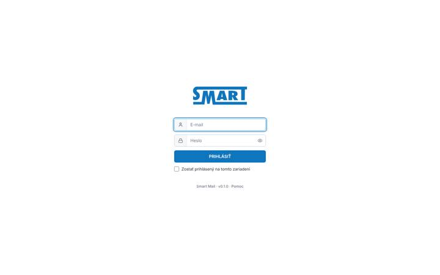 |  |

Differences: none known. The per-PR side-by-side reviews were resolved; other states are covered by `web/e2e/phase1*.spec.ts`.

### W1c

Figma: [W1c Heslo sa zmenilo](https://www.figma.com/design/vBDv8OCQTjxPBMzq6KBcHU?node-id=27-25690)

| Desktop (1440 × 900) | Mobile (390 × 844) |
|---|---|
| 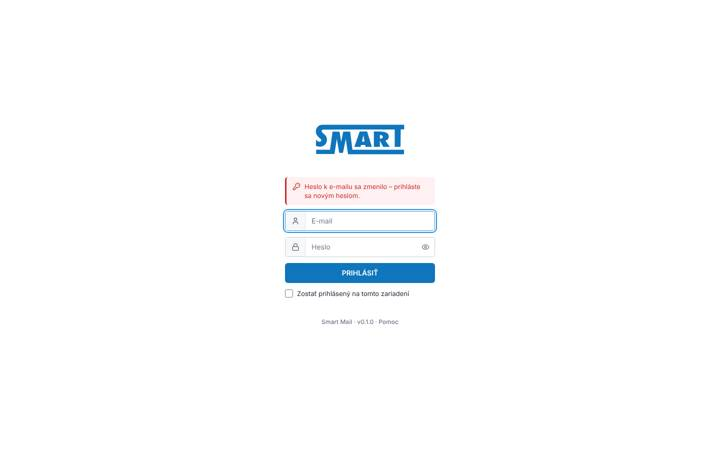 | 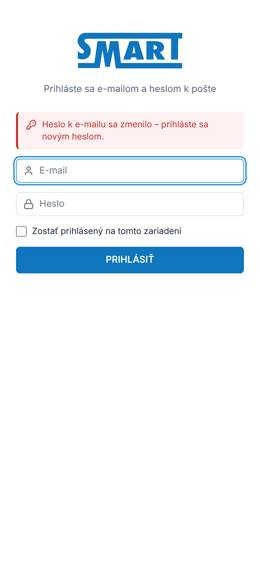 |

Differences: none known. The per-PR side-by-side reviews were resolved; other states are covered by `web/e2e/phase1*.spec.ts`.

### W1a

Figma: [W1a Overenie (2FA)](https://www.figma.com/design/vBDv8OCQTjxPBMzq6KBcHU?node-id=27-25760)

| Desktop (1440 × 900) | Mobile (390 × 844) |
|---|---|
| 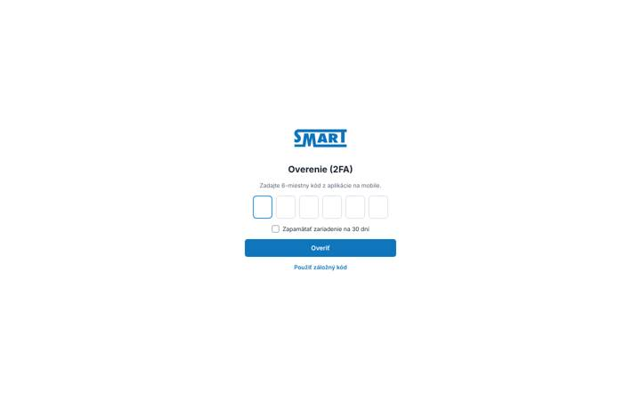 | 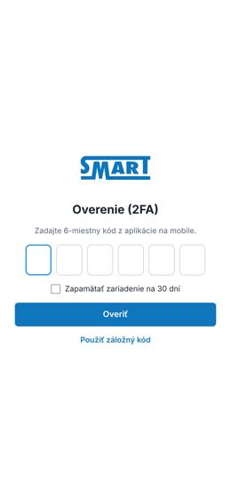 |

Differences: none known. The per-PR side-by-side reviews were resolved; other states are covered by `web/e2e/phase1*.spec.ts`.

### W1b

Figma: [W1b Kto ste?](https://www.figma.com/design/vBDv8OCQTjxPBMzq6KBcHU?node-id=27-25825)

| Desktop (1440 × 900) | Mobile (390 × 844) |
|---|---|
| 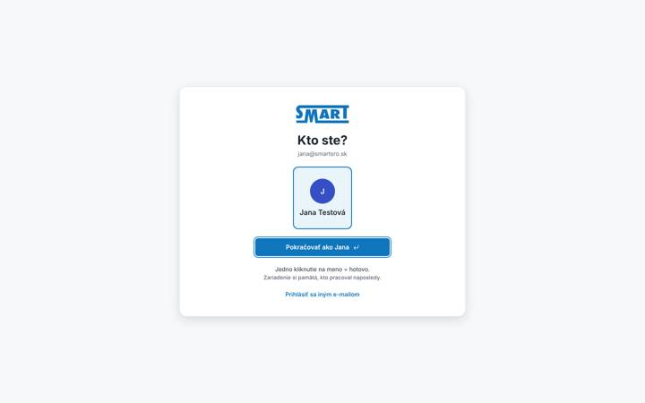 | 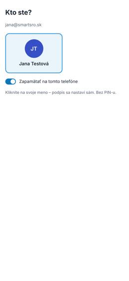 |

Differences: none known. The per-PR side-by-side reviews were resolved; other states are covered by `web/e2e/phase1*.spec.ts`.

### W2

Figma: [W2 Doručená pošta (predvolené)](https://www.figma.com/design/vBDv8OCQTjxPBMzq6KBcHU?node-id=20-2)

| Desktop (1440 × 900) | Mobile (390 × 844) |
|---|---|
| 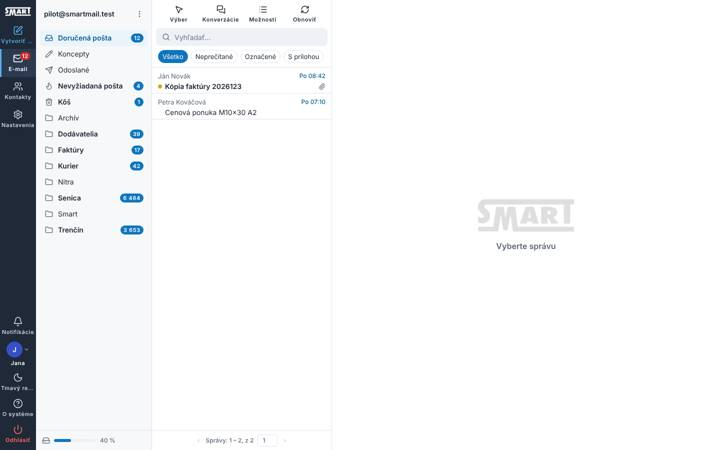 | 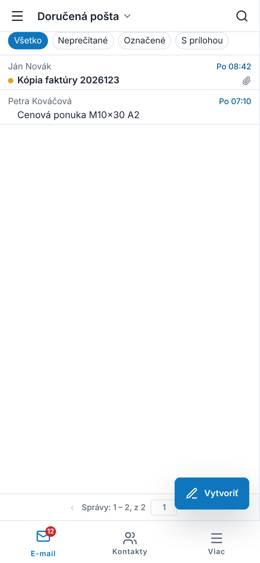 |

Differences: none known. The per-PR side-by-side reviews were resolved; other states are covered by `web/e2e/phase1*.spec.ts`.

### W2c

Figma: [W2c Vlákno – doklad dodávateľa (Príjem tovaru)](https://www.figma.com/design/vBDv8OCQTjxPBMzq6KBcHU?node-id=22-6603)

| Desktop (1440 × 900) | Mobile (390 × 844) |
|---|---|
| 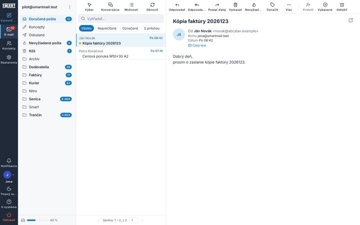 | 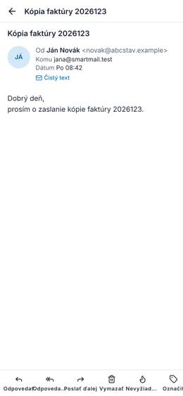 |

Differences: none known. The per-PR side-by-side reviews were resolved; other states are covered by `web/e2e/phase1*.spec.ts`.

### W9

Figma: [W9 Kontakty – osobný kontakt](https://www.figma.com/design/vBDv8OCQTjxPBMzq6KBcHU?node-id=59-47915)

| Desktop (1440 × 900) | Mobile (390 × 844) |
|---|---|
| 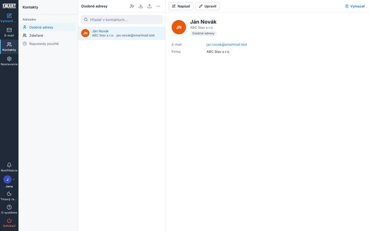 | 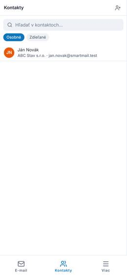 |

Differences: axe: the contrast of the avatar initials is tracked in #83.

### W4

Figma: [W4 Písanie – odpoveď (Možnosti a prílohy)](https://www.figma.com/design/vBDv8OCQTjxPBMzq6KBcHU?node-id=30-25635)

| Desktop (1440 × 900) | Mobile (390 × 844) |
|---|---|
| 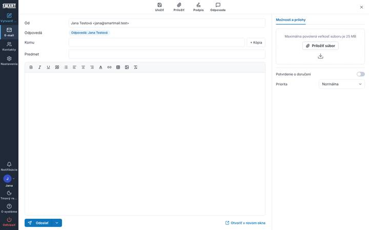 | 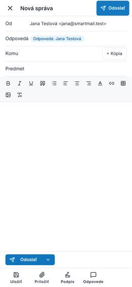 |

Differences: none known. The per-PR side-by-side reviews were resolved; other states are covered by `web/e2e/phase1*.spec.ts`.

### W12-01a

Figma: [W12-01a Používateľské rozhranie](https://www.figma.com/design/vBDv8OCQTjxPBMzq6KBcHU?node-id=62-51404)

| Desktop (1440 × 900) | Mobile (390 × 844) |
|---|---|
| 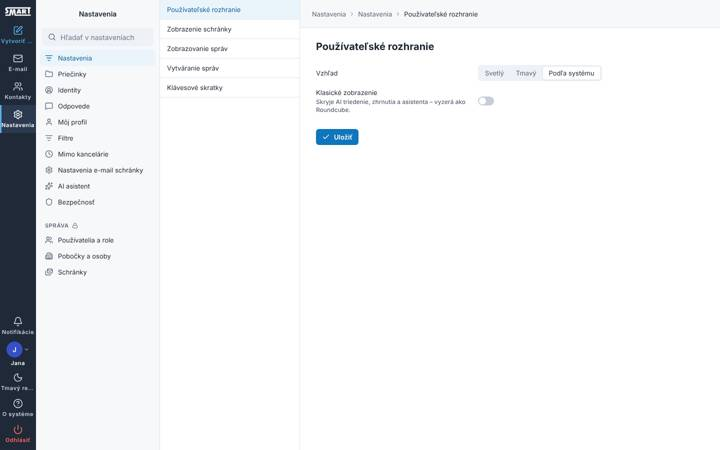 | 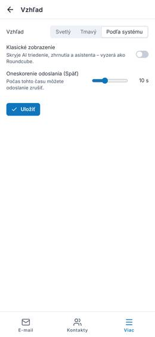 |

Differences: none known. The per-PR side-by-side reviews were resolved; other states are covered by `web/e2e/phase1*.spec.ts`.

### W12-01b

Figma: [W12-01b Zobrazenie schránky](https://www.figma.com/design/vBDv8OCQTjxPBMzq6KBcHU?node-id=62-52135)

| Desktop (1440 × 900) | Mobile (390 × 844) |
|---|---|
| 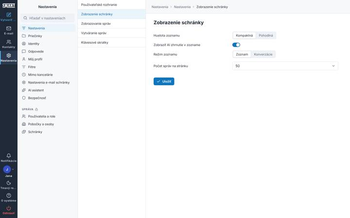 | 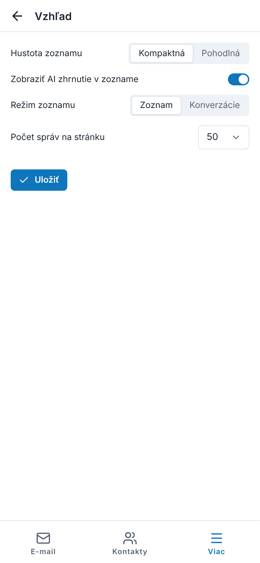 |

Differences: none known. The per-PR side-by-side reviews were resolved; other states are covered by `web/e2e/phase1*.spec.ts`.

### W12-01c

Figma: [W12-01c Zobrazovanie správ](https://www.figma.com/design/vBDv8OCQTjxPBMzq6KBcHU?node-id=62-52750)

| Desktop (1440 × 900) | Mobile (390 × 844) |
|---|---|
| 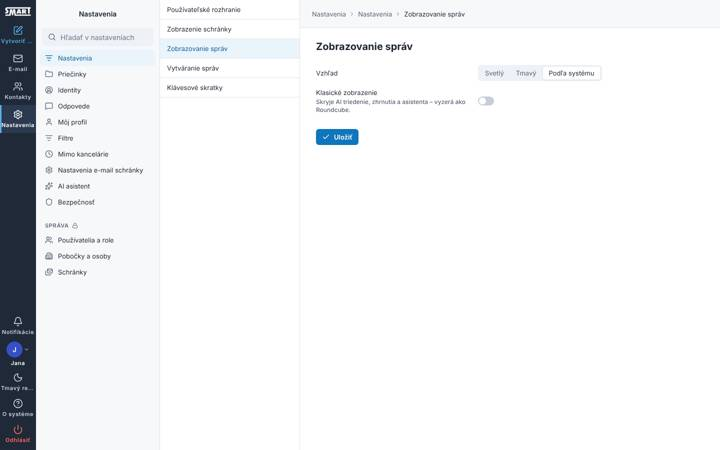 | 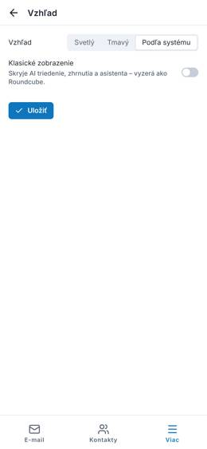 |

Differences: none known. The per-PR side-by-side reviews were resolved; other states are covered by `web/e2e/phase1*.spec.ts`.

### W12-01d

Figma: [W12-01d Vytváranie správ](https://www.figma.com/design/vBDv8OCQTjxPBMzq6KBcHU?node-id=62-53398)

| Desktop (1440 × 900) | Mobile (390 × 844) |
|---|---|
| 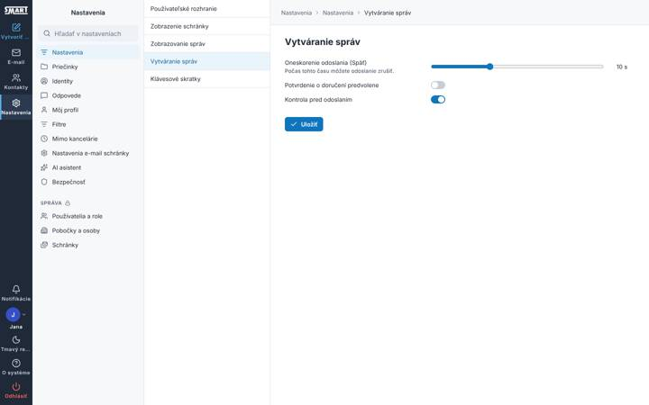 | 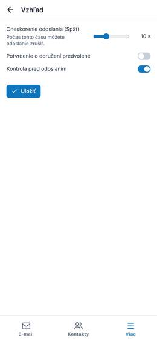 |

Differences: none known. The per-PR side-by-side reviews were resolved; other states are covered by `web/e2e/phase1*.spec.ts`.

### W12-01e

Figma: [W12-01e Klávesové skratky](https://www.figma.com/design/vBDv8OCQTjxPBMzq6KBcHU?node-id=78-74958)

| Desktop (1440 × 900) | Mobile (390 × 844) |
|---|---|
| 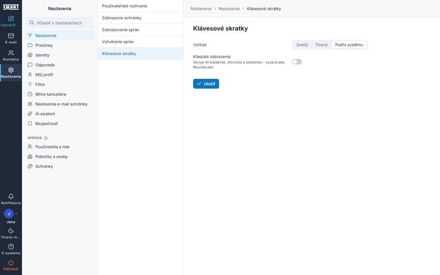 |  |

Differences: none known. The per-PR side-by-side reviews were resolved; other states are covered by `web/e2e/phase1*.spec.ts`.

### W12-02

Figma: [W12-02 Priečinky](https://www.figma.com/design/vBDv8OCQTjxPBMzq6KBcHU?node-id=64-53231)

| Desktop (1440 × 900) | Mobile (390 × 844) |
|---|---|
| 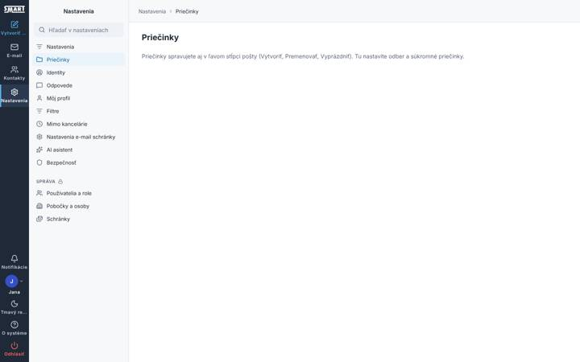 | 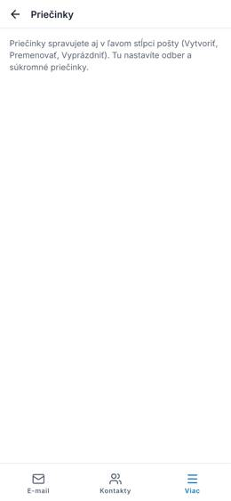 |

Differences: none known. The per-PR side-by-side reviews were resolved; other states are covered by `web/e2e/phase1*.spec.ts`.

### W12-03a

Figma: [W12-03a Identity](https://www.figma.com/design/vBDv8OCQTjxPBMzq6KBcHU?node-id=64-54466)

| Desktop (1440 × 900) | Mobile (390 × 844) |
|---|---|
| 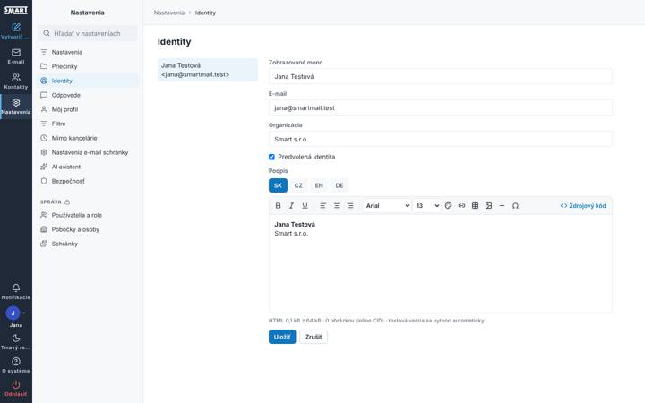 | 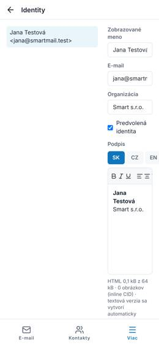 |

Differences: none known. The per-PR side-by-side reviews were resolved; other states are covered by `web/e2e/phase1*.spec.ts`.

### W12-03b

Figma: [W12-03b Môj profil](https://www.figma.com/design/vBDv8OCQTjxPBMzq6KBcHU?node-id=65-55239)

| Desktop (1440 × 900) | Mobile (390 × 844) |
|---|---|
| 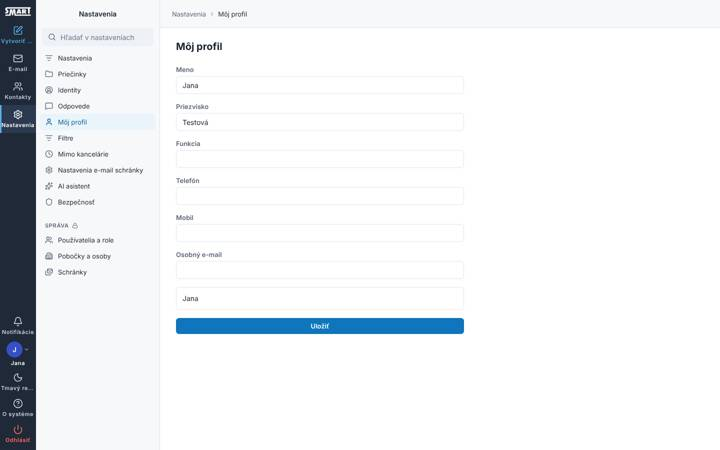 | 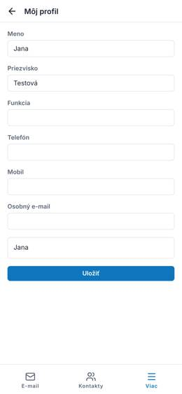 |

Differences: none known. The per-PR side-by-side reviews were resolved; other states are covered by `web/e2e/phase1*.spec.ts`.

### W12-04

Figma: [W12-04 Odpovede](https://www.figma.com/design/vBDv8OCQTjxPBMzq6KBcHU?node-id=65-56215)

| Desktop (1440 × 900) | Mobile (390 × 844) |
|---|---|
| 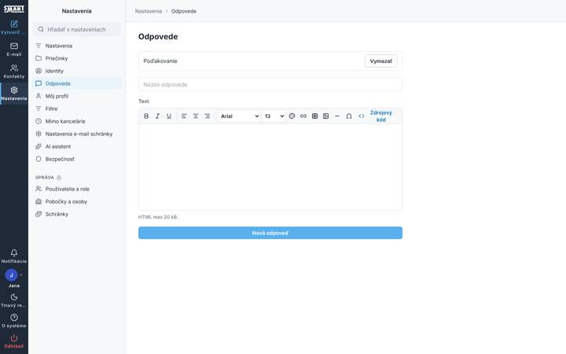 | 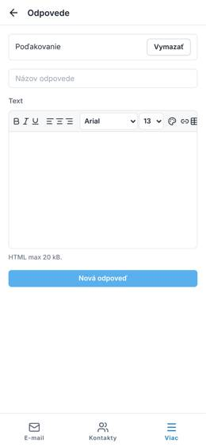 |

Differences: none known. The per-PR side-by-side reviews were resolved; other states are covered by `web/e2e/phase1*.spec.ts`.

### W12-05

Figma: [W12-05 Filtre](https://www.figma.com/design/vBDv8OCQTjxPBMzq6KBcHU?node-id=65-57283)

| Desktop (1440 × 900) | Mobile (390 × 844) |
|---|---|
| 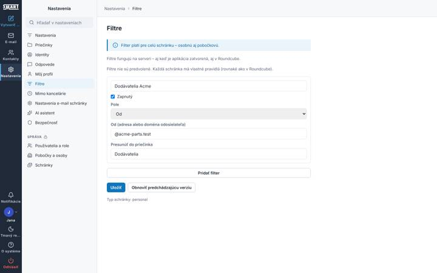 | 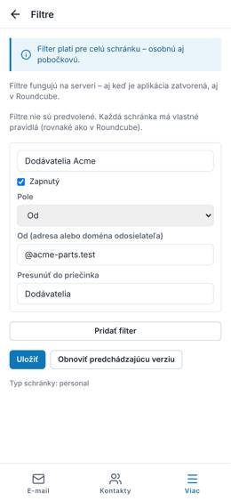 |

Differences: none known. The per-PR side-by-side reviews were resolved; other states are covered by `web/e2e/phase1*.spec.ts`.

### W12-06

Figma: [W12-06 Mimo kancelárie](https://www.figma.com/design/vBDv8OCQTjxPBMzq6KBcHU?node-id=65-58294)

| Desktop (1440 × 900) | Mobile (390 × 844) |
|---|---|
| 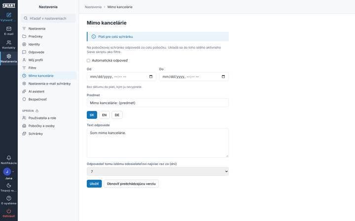 | 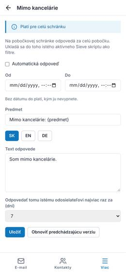 |

Differences: none known. The per-PR side-by-side reviews were resolved; other states are covered by `web/e2e/phase1*.spec.ts`.

### W12-09

Figma: [W12-09 Bezpečnosť](https://www.figma.com/design/vBDv8OCQTjxPBMzq6KBcHU?node-id=67-58683)

| Desktop (1440 × 900) | Mobile (390 × 844) |
|---|---|
| 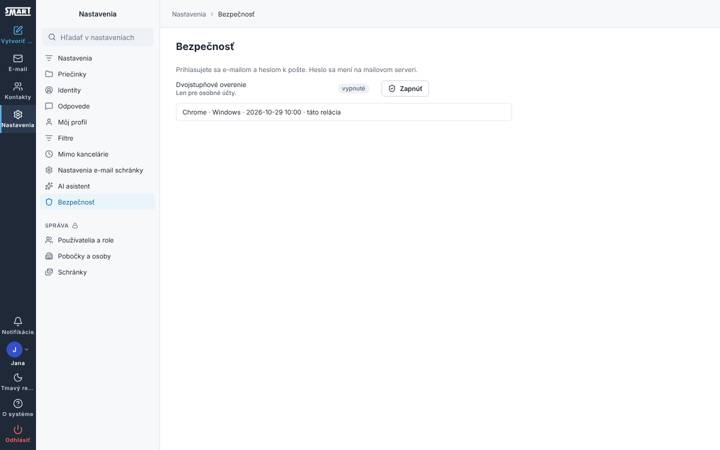 | 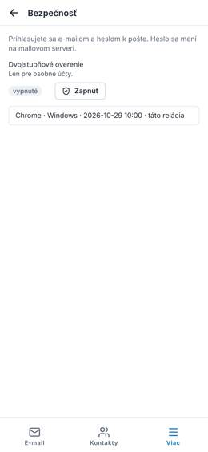 |

Differences: OIDC sign-in buttons are hidden until OIDC is configured. 2FA enrolment is only for personal accounts (#77, C1).

### W12-09b

Figma: [W12-09b Nastavenia e-mail schránky](https://www.figma.com/design/vBDv8OCQTjxPBMzq6KBcHU?node-id=67-59207)

| Desktop (1440 × 900) | Mobile (390 × 844) |
|---|---|
| 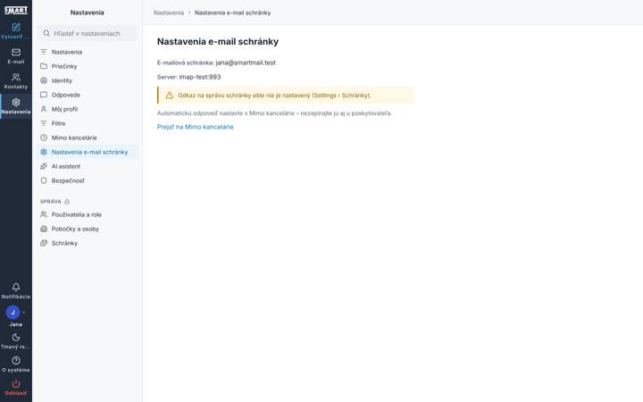 | 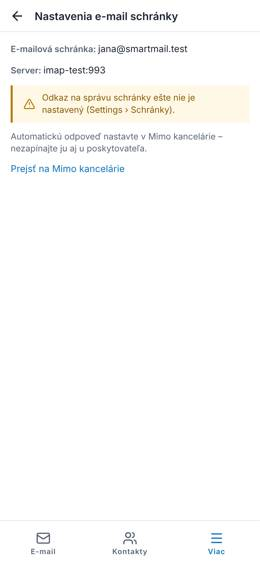 |

Differences: none known. The per-PR side-by-side reviews were resolved; other states are covered by `web/e2e/phase1*.spec.ts`.

### W12-10

Figma: [W12-10 Používatelia a role](https://www.figma.com/design/vBDv8OCQTjxPBMzq6KBcHU?node-id=68-59425)

| Desktop (1440 × 900) | Mobile (390 × 844) |
|---|---|
| 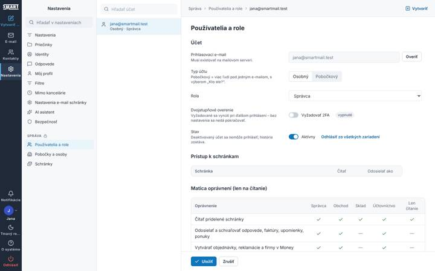 | 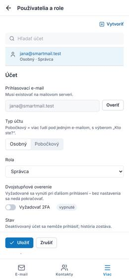 |

Differences: **Deliberate:** 2FA and OIDC are hidden from the list (Erik, #55). „Vymazať účet“ is omitted (Erik). The permission matrix is taken from PRODUCT_SPEC §4, not from the Figma sample. „Vyžadovať 2FA“ / „Resetovať 2FA“ come from #77.

### W12-11a

Figma: [W12-11a Pobočky a osoby – Údaje](https://www.figma.com/design/vBDv8OCQTjxPBMzq6KBcHU?node-id=68-60641)

| Desktop (1440 × 900) | Mobile (390 × 844) |
|---|---|
| 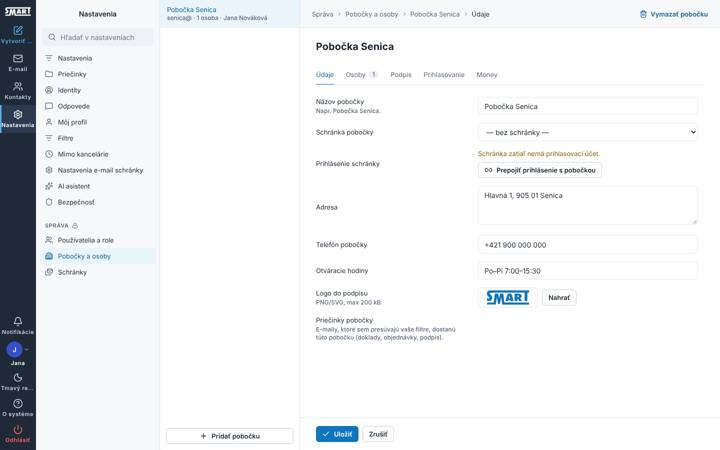 | 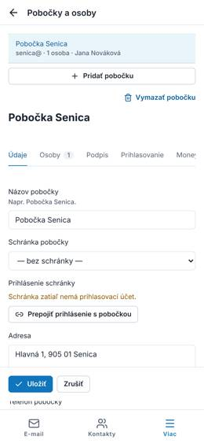 |

Differences: none known. The per-PR side-by-side reviews were resolved; other states are covered by `web/e2e/phase1*.spec.ts`.

### W12-11b

Figma: [W12-11b Pobočky a osoby – Osoby](https://www.figma.com/design/vBDv8OCQTjxPBMzq6KBcHU?node-id=68-61587)

| Desktop (1440 × 900) | Mobile (390 × 844) |
|---|---|
| 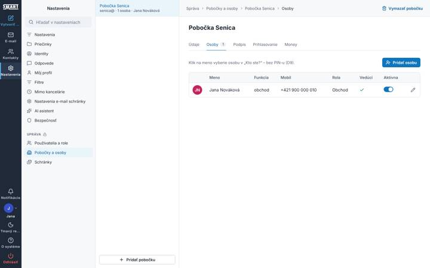 | 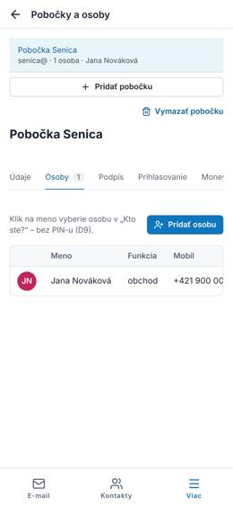 |

Differences: none known. The per-PR side-by-side reviews were resolved; other states are covered by `web/e2e/phase1*.spec.ts`.

### W12-11c

Figma: [W12-11c Pobočky a osoby – Podpis](https://www.figma.com/design/vBDv8OCQTjxPBMzq6KBcHU?node-id=72-61221)

| Desktop (1440 × 900) | Mobile (390 × 844) |
|---|---|
| 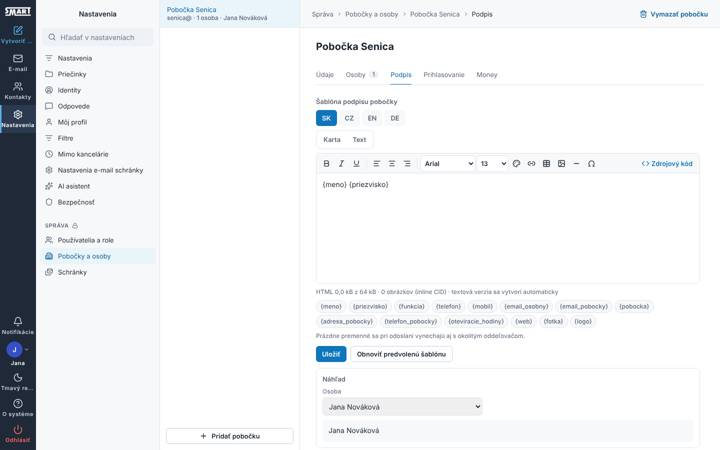 | 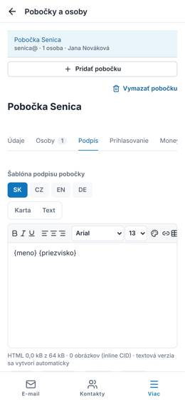 |

Differences: none known. The per-PR side-by-side reviews were resolved; other states are covered by `web/e2e/phase1*.spec.ts`.

### W12-11d

Figma: [W12-11d Pobočky a osoby – Prihlasovanie](https://www.figma.com/design/vBDv8OCQTjxPBMzq6KBcHU?node-id=72-62234)

| Desktop (1440 × 900) | Mobile (390 × 844) |
|---|---|
| 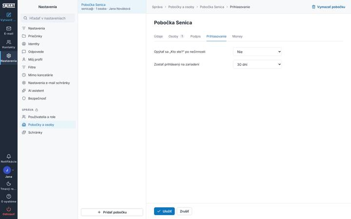 | 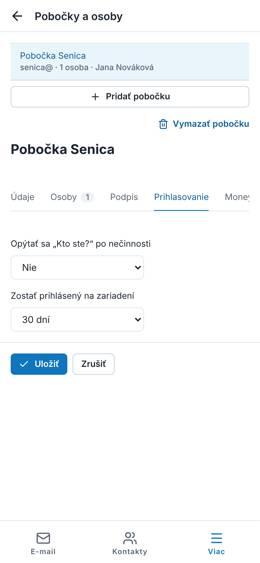 |

Differences: **Deliberate:** the alert for unhandled mail is deferred to Phase 5 (Erik, #55).

### W12-12

Figma: [W12-12 Schránky](https://www.figma.com/design/vBDv8OCQTjxPBMzq6KBcHU?node-id=73-64901)

| Desktop (1440 × 900) | Mobile (390 × 844) |
|---|---|
|  |  |

Differences: none known. The per-PR side-by-side reviews were resolved; other states are covered by `web/e2e/phase1*.spec.ts`.

### W13

Figma: [W13 Úvodná prehliadka – krok 1](https://www.figma.com/design/vBDv8OCQTjxPBMzq6KBcHU?node-id=78-75608)

| Desktop (1440 × 900) | Mobile (390 × 844) |
|---|---|
|  |  |

Differences: Mobile shows the M-W13 variant of the tour.

### W14

Figma: [W14 Notifikácie](https://www.figma.com/design/vBDv8OCQTjxPBMzq6KBcHU?node-id=79-78864)

| Desktop (1440 × 900) | Mobile (390 × 844) |
|---|---|
|  |  |

Differences: Phase 1 notification kinds only (sync failure, assignment). AI and Money kinds come in later phases.

### W15

Figma: [W15 Klávesové skratky](https://www.figma.com/design/vBDv8OCQTjxPBMzq6KBcHU?node-id=79-79758)

| Desktop (1440 × 900) | Mobile (390 × 844) |
|---|---|
|  | — (desktop only) |

Differences: Desktop only (keyboard). Shortcuts for later phases (Asistent) are hidden.

### W15b

Figma: [W15b O systéme](https://www.figma.com/design/vBDv8OCQTjxPBMzq6KBcHU?node-id=79-80033)

| Desktop (1440 × 900) | Mobile (390 × 844) |
|---|---|
|  |  |

Differences: none known. The per-PR side-by-side reviews were resolved; other states are covered by `web/e2e/phase1*.spec.ts`.

### W16a

Figma: [W16a 403 – Nemáte prístup](https://www.figma.com/design/vBDv8OCQTjxPBMzq6KBcHU?node-id=79-80796)

| Desktop (1440 × 900) | Mobile (390 × 844) |
|---|---|
|  |  |

Differences: none known. The per-PR side-by-side reviews were resolved; other states are covered by `web/e2e/phase1*.spec.ts`.

### W16b

Figma: [W16b 404 – Stránku sme nenašli](https://www.figma.com/design/vBDv8OCQTjxPBMzq6KBcHU?node-id=79-80913)

| Desktop (1440 × 900) | Mobile (390 × 844) |
|---|---|
|  |  |

Differences: none known. The per-PR side-by-side reviews were resolved; other states are covered by `web/e2e/phase1*.spec.ts`.

### W16c

Figma: [W16c 500 – Niečo sa pokazilo](https://www.figma.com/design/vBDv8OCQTjxPBMzq6KBcHU?node-id=79-81030)

| Desktop (1440 × 900) | Mobile (390 × 844) |
|---|---|
|  |  |

Differences: none known. The per-PR side-by-side reviews were resolved; other states are covered by `web/e2e/phase1*.spec.ts`.

### W17

Figma: [W17 Údržba](https://www.figma.com/design/vBDv8OCQTjxPBMzq6KBcHU?node-id=79-81704)

| Desktop (1440 × 900) | Mobile (390 × 844) |
|---|---|
|  |  |

Differences: none known. The per-PR side-by-side reviews were resolved; other states are covered by `web/e2e/phase1*.spec.ts`.
